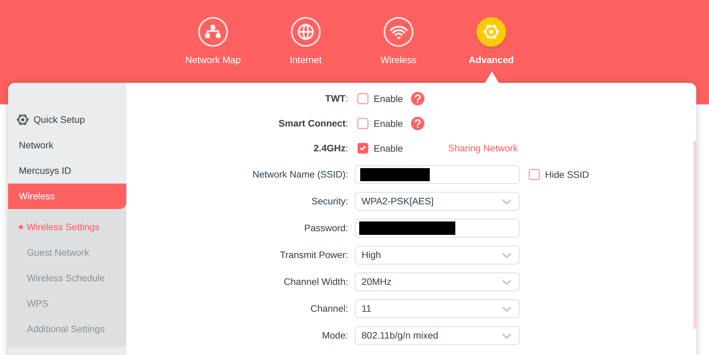

Important network requirements
- **2.4GHz should be disabled by default.**
- **2.4GHz Channel Width**: should NOT be "20/40MHz", as this is channel bonding (forbidden by rules).
- **2.4GHz Channel**:
  - Robot operations and comms checks to be performed on channel 1.
  - Channel 6 is only allowed for tests if authorised by the 'PitBoss'.
  - **DO NOT TRANSMIT ON CHANNEL 1 WITHOUT PERMISSION!**
  - There are no rules on channel 11; reasonable alternative to 1 or 6 for testing.

The image below shows the location of these settings.

